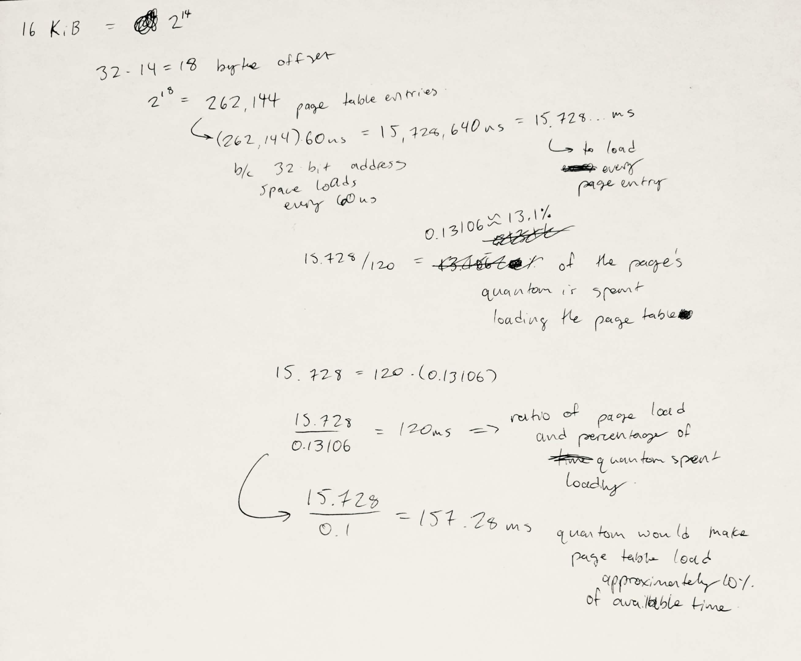
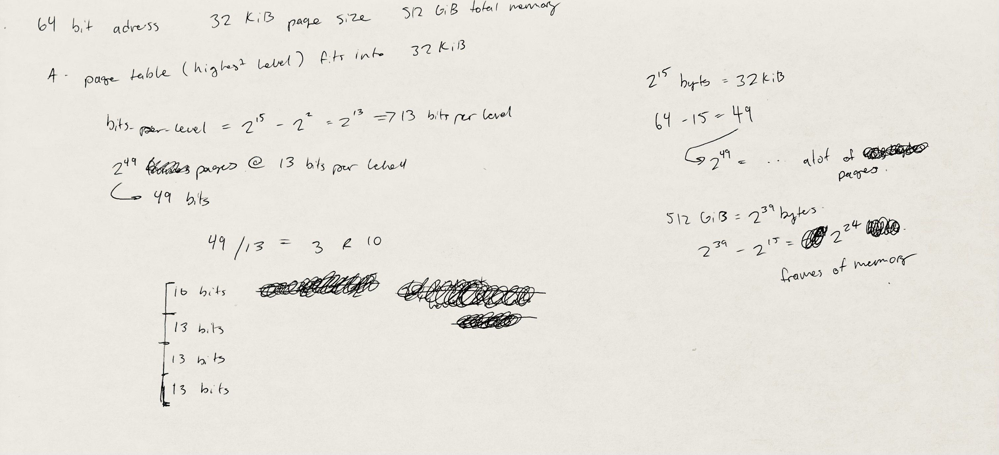
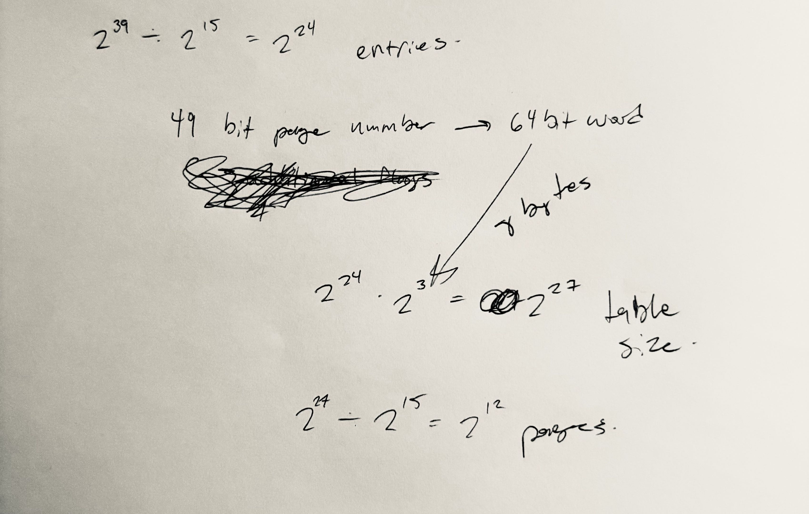

## Problem Set 3
_Tim Price_ · _2026-10-02_

1. It takes approx. `15.728 ms` to load every page entry, which is approx. `13.1%` of the process's quantom. For the quantom to spend approx. ten percent of its time loading the page table, the quantom would need to be approx. `157.28 ms` long. 

2-A. We should use 4 total layers and should use (from top to bottom) `[10:L1, 13:L2, 13:L3, 13:L4]` bits per level. 
Tracing a memory page, we would start from the root table at L1, lookup and point to L2, lookup and point to L3, then finally lookup and point to L4. The 13 bit L4 table directly corresponds to a dataframe and a 15 bit offset. (see figure 2.)

2-B. The page table size would be `2^27 Bytes` or `128 MiB` assuming we round up the 49 bit entry to a 64-bit word entry. That would mean the page table occupies `2^12` or `4096` pages. (see figure 3.)

[!note] I accidentally wrote some division as subtraction on my scratchwork. I don't want to retake the pictures so assume which operation I'm doing based on the numbers and their solution relative to them. 

